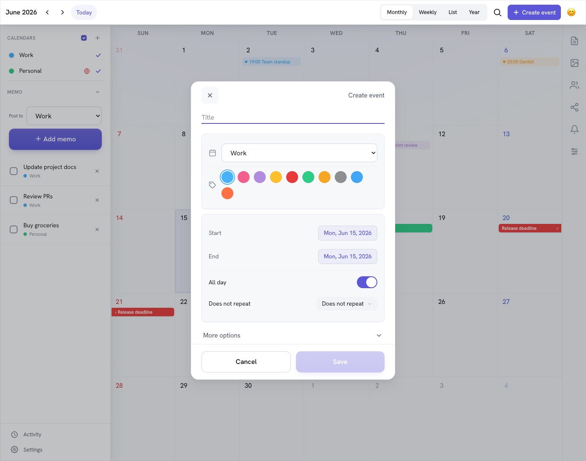
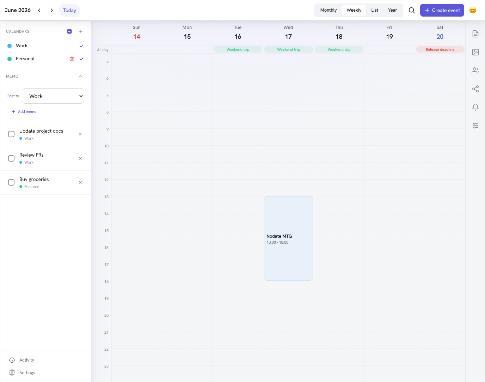
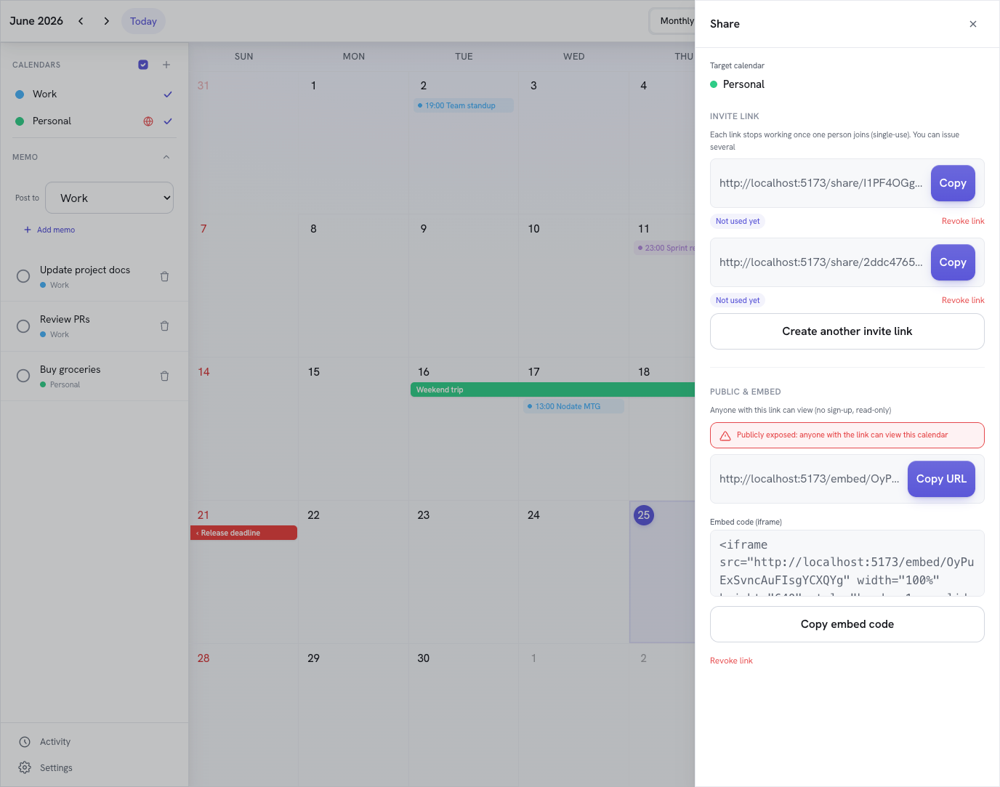
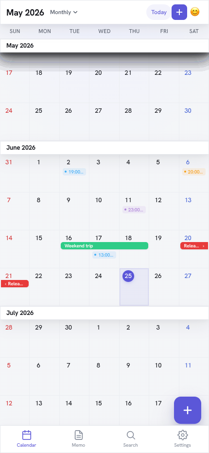

# Nodate Time

[](https://github.com/libraz/nodate-time/actions)
[](https://codecov.io/gh/libraz/nodate-time)
[](https://github.com/libraz/nodate-time/blob/main/LICENSE)
[](https://go.dev)
[](https://www.typescriptlang.org)

**Nodate Time is a shared calendar for running one calendar across several people: families, teams and agencies.**
It is self-hosted: a Go REST API and a React single-page app on MySQL and any S3-compatible object storage.

📖 **[Documentation](https://github.com/libraz/nodate-time/blob/main/docs/en/introduction.md)** &nbsp;·&nbsp; **[Getting started](#getting-started)** &nbsp;·&nbsp; **[Deployment](https://github.com/libraz/nodate-time/blob/main/docs/en/deployment.md)**

> Pre-1.0 and not independently security-audited.

## Screenshots

| Monthly view                                                                         | Weekly view                                                                        |
| ------------------------------------------------------------------------------------ | ---------------------------------------------------------------------------------- |
|  |                              |
| **Share & embed**                                                                    | **Mobile**                                                                         |
|        |  |

## What it does

- **Shared calendars** — per-member roles (owner / manager / editor / viewer) and colours, invite links, public share tokens, an embeddable view and an uploaded cover image. [API overview](https://github.com/libraz/nodate-time/blob/main/docs/en/api.md)
- **Events** — all-day and timed, recurrence (RRULE) with per-occurrence exceptions, drag to move or resize, an owner and participants, show-as (busy, free, tentative, out of office), per-event visibility on share links, calendar-defined labels that colour them, checklists, attachments, comments. [API overview](https://github.com/libraz/nodate-time/blob/main/docs/en/api.md)
- **Schedule polls** — send candidate times to members, collect their answers and turn the chosen time into an event; free time can be looked up across calendars that share their availability. [API overview](https://github.com/libraz/nodate-time/blob/main/docs/en/api.md)
- **Memos and albums** — per-calendar notes and photo albums, optionally linked to events. [Object storage](https://github.com/libraz/nodate-time/blob/main/docs/en/deployment.md#object-storage)
- **Change history** — a history for events and memos, plus a per-calendar activity feed. [API overview](https://github.com/libraz/nodate-time/blob/main/docs/en/api.md)
- **Sign-in** — email and password, Google and LINE OAuth, and a development-only password-less login. Password reset and email verification appear only when an SMTP relay is configured. [Configuration](https://github.com/libraz/nodate-time/blob/main/docs/en/configuration.md)
- **Admin** — OAuth provider settings and an allowlist of permitted sign-in emails and domains. [API overview](https://github.com/libraz/nodate-time/blob/main/docs/en/api.md)
- **Export and import** — export as iCal or CSV, import iCal. [API overview](https://github.com/libraz/nodate-time/blob/main/docs/en/api.md)
- **Calendar app sync** — a CalDAV server for iOS, macOS and other calendar apps, signed in with per-device app passwords; an iPhone or Mac is set up from a QR code or link. [App passwords](https://github.com/libraz/nodate-time/blob/main/docs/en/api.md#app-passwords) · [CalDAV](https://github.com/libraz/nodate-time/blob/main/docs/en/api.md#caldav)
- **Languages and themes** — English and Japanese, five themes, light, dark or system color mode, an in-app tour and help page.
- **Self-hosting** — one compose file with TLS, object storage and upgrade scripts. [Deployment](https://github.com/libraz/nodate-time/blob/main/docs/en/deployment.md)
- **Migrating from TimeTree** — `importtimetree` copies shared calendars with who owns and created each event, and can keep following them with `-sync`. [Migrating from TimeTree](https://github.com/libraz/nodate-time/blob/main/docs/en/deployment.md#migrating-from-timetree)
- **Metrics and profiling** — Prometheus metrics, pprof and a per-dependency health report on a separate listener. [Observability](https://github.com/libraz/nodate-time/blob/main/docs/en/observability.md)
- **Optional shared database** — can share one MySQL with [nodate-flow](https://github.com/libraz/nodate-flow) through a published schema contract, with no code dependency. [Introduction](https://github.com/libraz/nodate-time/blob/main/docs/en/introduction.md#optional-shared-database-with-nodate-flow)

## Getting started

Local development requires [Bun](https://bun.sh) 1.4.5 or later, Node.js 26.13.1, Go 1.26.10 or later, and Docker for MySQL and object storage. Use [sqlc](https://sqlc.dev) 1.31.1 to regenerate the database code. A host `mysql` client is needed by `make test-conformance` and `make test-upgrade-path`, and `make check-core-pin` needs network access to GitHub.

```sh
bun install
git config core.hooksPath .githooks   # pre-commit hook: refuses edits to the vendored sql/core
make db-up             # MySQL on port 33306 (TC_DB_PORT)
make db-seed           # schema, demo@example.com / admin@example.com (password123), sample data
make storage-up        # object storage: attachments, albums and avatars need it
make dev               # MySQL + mailpit + API + web together
```

- Web: <http://localhost:5173>
- API: <http://localhost:8080> (`/health`, OpenAPI at `/openapi.json`, reference at `/docs`)
- Mail caught by mailpit: <http://localhost:8025>

Without `make storage-up`, the attachment, album and avatar endpoints answer 503. With `TC_ENV=development`, which `make dev` sets, `/auth/dev-login` signs in the seeded accounts without a password.

To host it for real, see [Deployment](https://github.com/libraz/nodate-time/blob/main/docs/en/deployment.md).

## Build from source

```sh
make dev                # DB + API + web
make db-up / db-down    # start / stop MySQL
make db-apply           # build the schema and apply it to an empty database
make sqlc               # regenerate the sqlc code
make verify-codegen     # fail when generated files are out of date
make build-api          # API binary at bin/api
make create-user ARGS="-email a@b.com -password secret123 -admin"
make format             # gofmt + Biome autofix
make lint               # gofmt check + Biome, no writes
make test-api           # Go unit tests
make test-e2e           # E2E against MySQL (TC_TEST_INTEGRATION=1)
make test-e2e-storage   # E2E including the object storage tests
bun run typecheck       # tsc -b
```

Repository layout, testing, migrations and code generation are in [Development](https://github.com/libraz/nodate-time/blob/main/docs/en/development.md). To contribute, see [CONTRIBUTING.md](CONTRIBUTING.md).

## Documentation

The documentation lives in [`docs/en`](https://github.com/libraz/nodate-time/tree/main/docs/en).

- **Learn** — [Introduction](https://github.com/libraz/nodate-time/blob/main/docs/en/introduction.md)
- **Guides** — [Development](https://github.com/libraz/nodate-time/blob/main/docs/en/development.md) · [Deployment](https://github.com/libraz/nodate-time/blob/main/docs/en/deployment.md) · [Observability](https://github.com/libraz/nodate-time/blob/main/docs/en/observability.md)
- **Reference** — [Configuration](https://github.com/libraz/nodate-time/blob/main/docs/en/configuration.md) · [API overview](https://github.com/libraz/nodate-time/blob/main/docs/en/api.md)

## License

[AGPL-3.0](LICENSE)
