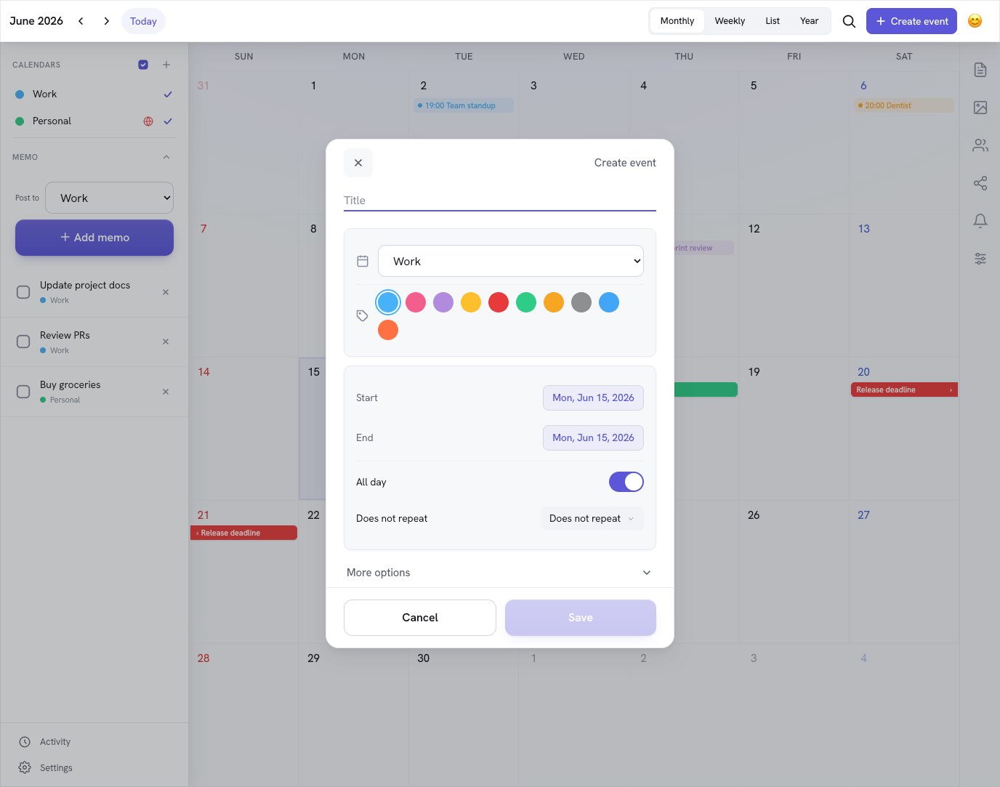
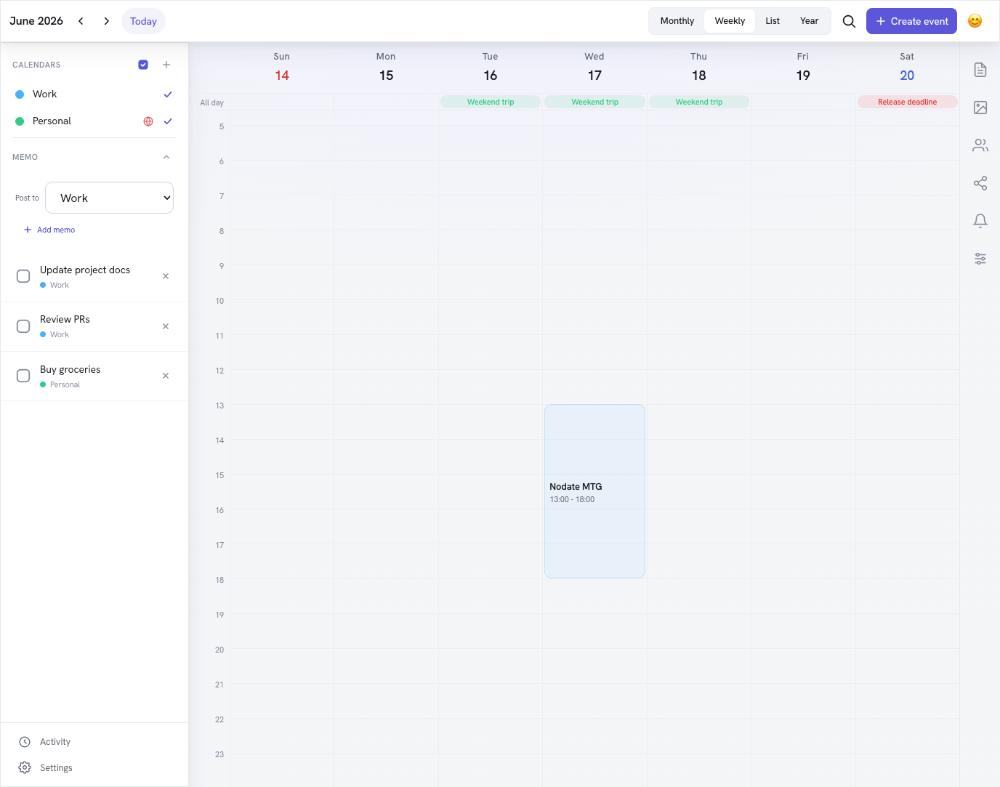
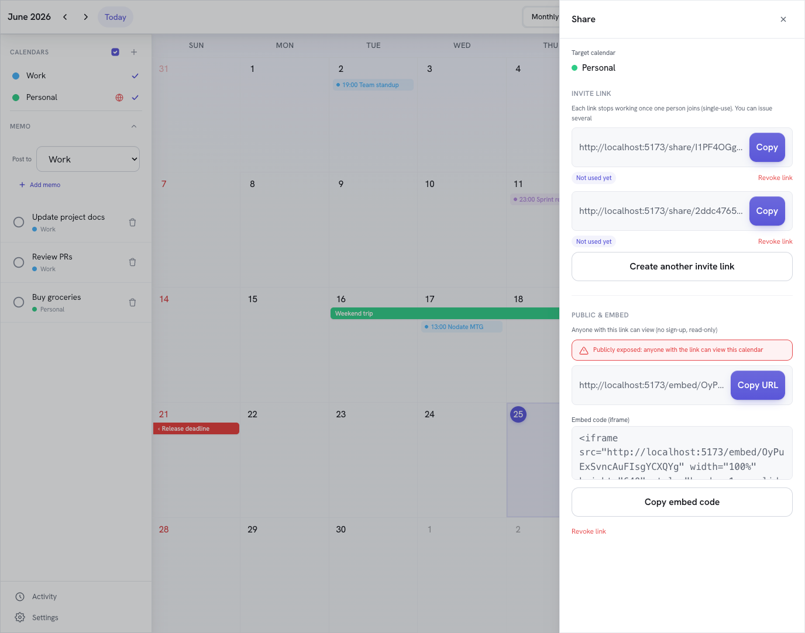
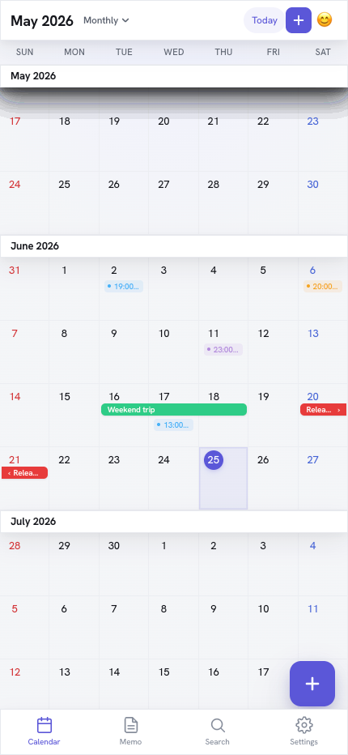

# Nodate Time

[](https://github.com/libraz/nodate-time/actions)
[](https://codecov.io/gh/libraz/nodate-time)
[](https://github.com/libraz/nodate-time/blob/main/LICENSE)
[](https://go.dev)
[](https://www.typescriptlang.org)

**Nodate Time は、家族・チーム・事務所など複数人で 1 つのカレンダーを運用するための共有カレンダーです。**
自己ホスト型で、Go 製の REST API と React のシングルページアプリが、MySQL と S3 互換のオブジェクトストレージの上で動きます。

📖 **[ドキュメント](https://github.com/libraz/nodate-time/blob/main/docs/ja/introduction.md)** &nbsp;·&nbsp; **[はじめに](#はじめに)** &nbsp;·&nbsp; **[デプロイ](https://github.com/libraz/nodate-time/blob/main/docs/ja/deployment.md)**

> 1.0 前であり、第三者によるセキュリティ監査は受けていません。

## スクリーンショット

| 月表示                                                                          | 週表示                                                                          |
| ------------------------------------------------------------------------------- | ------------------------------------------------------------------------------- |
|  |                           |
| **共有・埋め込み**                                                              | **モバイル**                                                                    |
|         |  |

## できること

- **カレンダー共有** — メンバーごとのロール（owner / manager / editor / viewer）と色、招待リンク、公開共有トークン、埋め込みビュー、アップロードしたカバー画像。[API 概要](https://github.com/libraz/nodate-time/blob/main/docs/ja/api.md)
- **予定** — 終日・時間指定、例外日を持てる繰り返し（RRULE）、ドラッグでの移動とリサイズ、担当者と参加者、空き状況（予定あり・空き・仮・不在）、公開リンクでの予定ごとの公開範囲、カレンダーで定義して色を付けるラベル、チェックリスト・添付ファイル・コメント。[API 概要](https://github.com/libraz/nodate-time/blob/main/docs/ja/api.md)
- **日程調整** — 候補日時をメンバーに送って回答を集め、決まった日時をそのまま予定にします。空き状況を共有しているカレンダーをまたいで空き時間を調べられます。[API 概要](https://github.com/libraz/nodate-time/blob/main/docs/ja/api.md)
- **メモとアルバム** — カレンダー単位のメモと写真アルバム。アルバムは予定に紐付けられます。[オブジェクトストレージ](https://github.com/libraz/nodate-time/blob/main/docs/ja/deployment.md#オブジェクトストレージ)
- **変更履歴** — 予定とメモの履歴と、カレンダー単位のアクティビティフィード。[API 概要](https://github.com/libraz/nodate-time/blob/main/docs/ja/api.md)
- **サインイン** — メール+パスワード、Google と LINE の OAuth、開発用のパスワードレスログイン。パスワード再設定とメール確認は SMTP リレーを設定したときだけ使えます。[設定](https://github.com/libraz/nodate-time/blob/main/docs/ja/configuration.md)
- **管理者機能** — OAuth プロバイダ設定と、サインインを許可するメール・ドメインのアロウリスト。[API 概要](https://github.com/libraz/nodate-time/blob/main/docs/ja/api.md)
- **エクスポートとインポート** — エクスポートは iCal と CSV、インポートは iCal。[API 概要](https://github.com/libraz/nodate-time/blob/main/docs/ja/api.md)
- **カレンダーアプリとの同期** — iOS・macOS などのカレンダーアプリ向けの CalDAV サーバー。端末ごとのアプリパスワードでサインインし、iPhone と Mac は QR コードかリンクから設定できます。[アプリパスワード](https://github.com/libraz/nodate-time/blob/main/docs/ja/api.md#アプリパスワード) · [CalDAV](https://github.com/libraz/nodate-time/blob/main/docs/ja/api.md#caldav)
- **多言語とテーマ** — 日本語と英語、5 種類のテーマ、ライト・ダーク・システム連動のカラーモード、月曜・日曜・土曜から選べる週の開始日、アプリ内ツアーとヘルプページ。
- **自己ホスト** — TLS、オブジェクトストレージ、更新手順をそろえた compose ファイル 1 つ。[デプロイ](https://github.com/libraz/nodate-time/blob/main/docs/ja/deployment.md)
- **TimeTree からの移行** — `importtimetree` が共有カレンダーを、予定ごとの担当者と作成者を保ったまま取り込みます。`-sync` で取り込み後も追従できます。[TimeTree からの移行](https://github.com/libraz/nodate-time/blob/main/docs/ja/deployment.md#timetree-からの移行)
- **メトリクスとプロファイル** — Prometheus メトリクス、pprof、依存先ごとのヘルスレポートを別リスナーで提供。[可観測性](https://github.com/libraz/nodate-time/blob/main/docs/ja/observability.md)
- **任意の共有データベース** — 公開されたスキーマ契約を介して、[nodate-flow](https://github.com/libraz/nodate-flow) と 1 つの MySQL を共有できます。コード依存はありません。[概要](https://github.com/libraz/nodate-time/blob/main/docs/ja/introduction.md#nodate-flow-との任意の共有データベース)

## はじめに

ローカル開発には [Bun](https://bun.sh) 1.4.5 以上、Node.js 26.13.1、Go 1.26.10 以上、MySQL とオブジェクトストレージを動かす Docker が必要です。DB のコードを再生成する場合は [sqlc](https://sqlc.dev) 1.31.1 を使います。ホストの `mysql` クライアントは `make test-conformance` と `make test-upgrade-path` に必要で、`make check-core-pin` は GitHub へのネットワークアクセスを必要とします。

```sh
bun install
git config core.hooksPath .githooks   # pre-commit フック: vendor した sql/core の編集を拒否
make db-up             # MySQL をポート 33306（TC_DB_PORT）で起動
make db-seed           # スキーマ、demo@example.com / admin@example.com（password123）、サンプルデータ
make storage-up        # オブジェクトストレージ。添付・アルバム・アバターに必要
make dev               # MySQL + mailpit + API + Web を一括起動
```

- Web: <http://localhost:5173>
- API: <http://localhost:8080>（`/health`、OpenAPI は `/openapi.json`、リファレンスは `/docs`）
- mailpit が受け取る送信メール: <http://localhost:8025>

`make storage-up` をしないと、添付・アルバム・アバターのエンドポイントは 503 を返します。`make dev` は `TC_ENV=development` で起動するので、`/auth/dev-login` でシードしたアカウントにパスワードなしでサインインできます。

本番で運用する場合は[デプロイ](https://github.com/libraz/nodate-time/blob/main/docs/ja/deployment.md)を参照してください。

## ソースからビルド

```sh
make dev                # DB + API + Web
make db-up / db-down    # MySQL の起動 / 停止
make db-apply           # スキーマを組み立てて空の DB に適用
make sqlc               # sqlc コードを再生成
make verify-codegen     # 生成物が古ければ失敗
make build-api          # API バイナリ（bin/api）
make create-user ARGS="-email a@b.com -password secret123 -admin"
make format             # gofmt + Biome 自動修正
make lint               # gofmt チェック + Biome（書き込みなし）
make test-api           # Go ユニットテスト
make test-e2e           # MySQL に対する E2E（TC_TEST_INTEGRATION=1）
make test-e2e-storage   # オブジェクトストレージのテストを含む E2E
bun run typecheck       # tsc -b
```

ディレクトリ構成、テスト、マイグレーション、コード生成は[開発](https://github.com/libraz/nodate-time/blob/main/docs/ja/development.md)にあります。コントリビュートの手順は [CONTRIBUTING.md](CONTRIBUTING.md) を参照してください。

## ドキュメント

ドキュメントは [`docs/ja`](https://github.com/libraz/nodate-time/tree/main/docs/ja) にあります。

- **学ぶ** — [概要](https://github.com/libraz/nodate-time/blob/main/docs/ja/introduction.md)
- **ガイド** — [開発](https://github.com/libraz/nodate-time/blob/main/docs/ja/development.md) · [デプロイ](https://github.com/libraz/nodate-time/blob/main/docs/ja/deployment.md) · [可観測性](https://github.com/libraz/nodate-time/blob/main/docs/ja/observability.md)
- **リファレンス** — [設定](https://github.com/libraz/nodate-time/blob/main/docs/ja/configuration.md) · [API 概要](https://github.com/libraz/nodate-time/blob/main/docs/ja/api.md)

## ライセンス

[AGPL-3.0](LICENSE)
