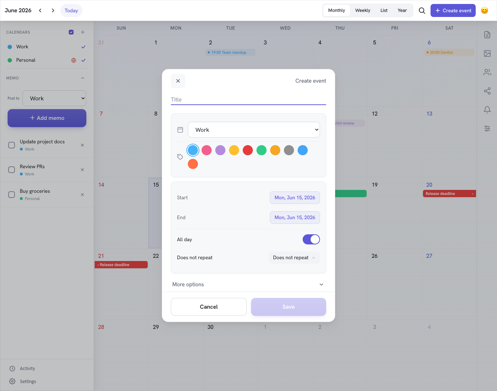
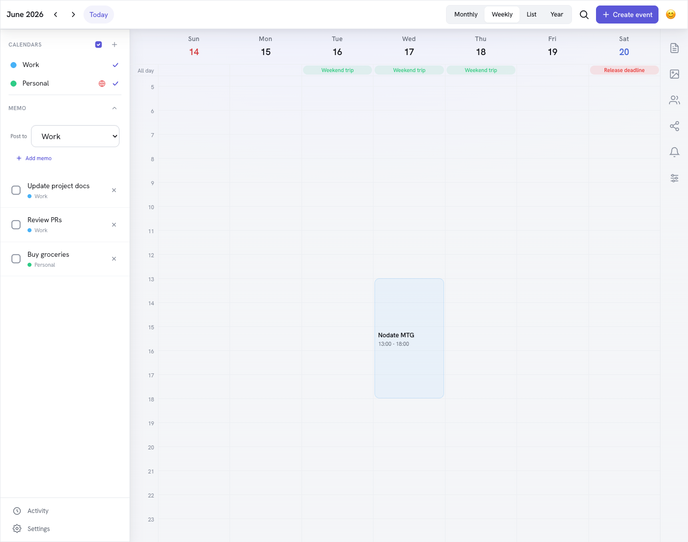
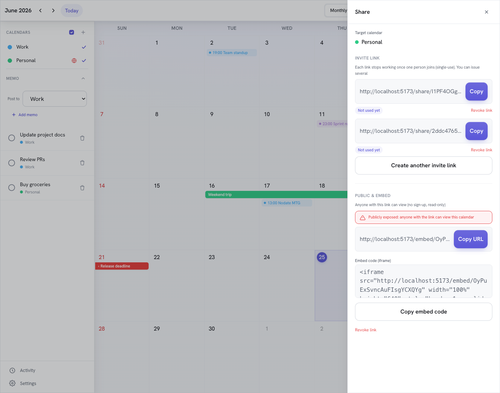
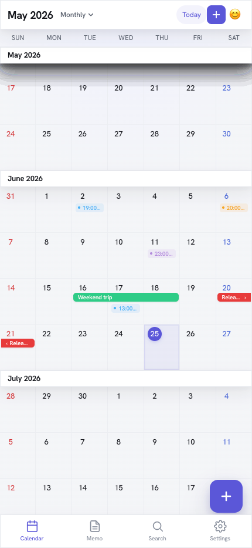

# Nodate Time

[](https://github.com/libraz/nodate-time/actions/workflows/ci.yml)
[](./LICENSE)


共有カレンダーアプリ。家族・チーム・タレント事務所など、複数人で 1 つのカレンダーを運用するためのグループカレンダー。Go 製の REST API と React SPA のモノレポ構成。

## スクリーンショット

| 月表示 | 週表示 |
| --- | --- |
|  |  |
| **共有・埋め込み** | |
|  | |

モバイル表示（縦スクロールの月表示）:

<p align="left">
  
</p>

## 主な機能

- **カレンダー共有** — メンバーごとのロール（owner / manager / editor / viewer）、招待リンク発行、公開共有トークン、外部埋め込み（embed）ビュー
- **予定（イベント）** — 終日・時間指定、繰り返し（RRULE）と例外日編集、ドラッグでの移動・リサイズ、参加者・チェックリスト・添付ファイル・コメント
- **メモ** — カレンダー単位のメモ
- **アルバム** — カレンダーごとの写真アルバム（イベントへの紐付け可）
- **アクティビティ / 監査履歴** — イベント・メモの変更履歴とカレンダー単位のアクティビティフィード
- **認証** — メール+パスワード、Google / LINE の OAuth/OIDC ログイン、パスワードリセット、開発用パスワードレスログイン
- **管理者機能** — OAuth プロバイダ設定、サインイン許可メール/ドメインのアロウリスト
- **エクスポート / インポート** — iCal・CSV
- **多言語 / テーマ** — 日本語・英語の i18n、テーマ切り替え

## 技術スタック

| 領域 | 採用技術 |
| --- | --- |
| API | Go 1.26 + [Huma v2](https://huma.rocks)（OpenAPI）+ chi/v5 + [sqlc](https://sqlc.dev) |
| DB | MySQL 8.4（Docker Compose） |
| オブジェクトストレージ | S3 互換（ローカルは MinIO） |
| Web | React 19 + TypeScript + Vite + TanStack Router + Zustand + Tailwind CSS 4 + Luxon |
| Lint / Format | Biome（Web）/ gofmt（Go） |
| パッケージマネージャ | Bun |
| テスト | Go E2E（testify + 実 MySQL）/ Vitest（Web） |

## ディレクトリ構成

```
apps/
  api/                 Go REST API
    cmd/api/           エントリポイント
    cmd/createuser/    ユーザー作成 CLI
    cmd/healthcheck/   コンテナのヘルスチェック
    internal/          config, auth, audit, cleanup, db/generated,
                       errors, mailer, recurrence, secrets, storage,
                       http/{handlers,middleware,router}
    tests/e2e/         E2E テスト
  web/                 React SPA
    src/components/     UI コンポーネント
    src/routes/         TanStack Router（file-based, share/ embed/ 含む）
    src/stores/         Zustand（auth / calendar / ui ストア）
    src/lib/            ユーティリティ（date, recurrence, upload, theme 等）
    src/i18n/           日本語 / 英語ロケール
sql/
  core/                共有スキーマ契約の vendor コピー（上流に固定、編集不可）
    tables/             共有テーブル定義
    triggers/           共有トリガ
    conformance/        契約適合チェック
  time/                本アプリ固有のテーブル
    tables/             テーブル定義
    alters/             差分適用
  queries/             sqlc クエリ定義
  schema.sql           build-schema.sh で生成される結合スキーマ
  sqlc.yaml            sqlc 設定
compose.yml            MySQL + MinIO のローカルスタック
compose.prod.yml       自己ホスト用スタック（MySQL + MinIO + API + Web）
```

## セットアップ

### 必要なもの

- [Bun](https://bun.sh)
- Go 1.26+
- Docker（MySQL / MinIO 用）
- [sqlc](https://sqlc.dev)（コード生成する場合）

### 起動

```bash
bun install            # 依存インストール（Bun 必須）
make db-up             # MySQL 起動（compose.yml）
make db-apply          # スキーマ生成・適用
make db-seed-users     # demo@example.com / admin@example.com を作成
make dev               # DB + API + Web を一括起動
```

- API: <http://localhost:8080>（`/health`, OpenAPI は Huma が生成）
- Web: <http://localhost:5173>

開発環境（`TC_ENV=development`）では `/auth/dev-login` でシードユーザーにパスワードレスログインできる。

### よく使うコマンド

```bash
make dev               # DB + API + Web を並列起動
make db-up / db-down   # MySQL の起動 / 停止
make db-apply          # スキーマ適用（build-schema.sh → schema.sql）
make db-seed           # スキーマ適用 + ユーザー + サンプルデータ
make minio-up          # MinIO（S3 互換ストレージ）起動
make sqlc              # sqlc コード生成
make api / make web    # 個別起動
make build-api         # API バイナリビルド（bin/api）
make create-user ARGS="-email a@b.com -password secret123 -admin"
make format            # gofmt + Biome 自動修正
make lint              # gofmt チェック + Biome（書き込みなし）
make test-api          # Go ユニットテスト
make test-e2e          # E2E（要 MySQL + TC_TEST_INTEGRATION=1）
make test-e2e-storage  # MinIO を使うストレージ系も含めた E2E

bun run check          # Biome チェック
bun run typecheck      # TypeScript 型チェック（tsc -b）
cd apps/web && bun run test   # Web ユニットテスト（Vitest）
```

## 環境変数

すべて `TC_` プレフィックス。主要なもの（詳細・デフォルト値は `apps/api/internal/config/config.go`）:

| 変数 | 用途 | デフォルト |
| --- | --- | --- |
| `TC_ENV` | `development` で開発用機能を有効化 | `production` |
| `TC_PORT` | API ポート | `8080` |
| `TC_DB_DSN` | MySQL DSN | `ttuser:ttpw@tcp(127.0.0.1:33306)/timetree_clone?parseTime=true` |
| `TC_JWT_SECRET` | JWT 署名鍵（本番は 32 バイト以上必須） | dev フォールバック |
| `TC_PASSWORD_LOGIN_ENABLED` | メール+パスワード認証の有効化 | `true` |
| `TC_CORS_ALLOWED_ORIGINS` | CORS 許可オリジン（本番はワイルドカード不可） | localhost:5173 |
| `TC_TRUSTED_PROXIES` | `X-Forwarded-For` の設定を信頼するリバースプロキシ（CIDR または IP、カンマ区切り）。プロキシ配下で未設定だと全クライアントが 1 つのレート制限バケットに集約される | 信頼しない |
| `TC_AUTH_RATE_LIMIT` | サインイン・登録・パスワード再設定・OAuth の IP あたり req/min | `60` |
| `TC_SHARE_RATE_LIMIT` | 公開共有リンクの IP あたり req/min（サインインとは別枠） | `600` |
| `TC_WEB_URL` / `TC_API_PUBLIC_URL` | フロント / API の公開 URL | localhost |
| `TC_S3_ENDPOINT` / `TC_S3_ACCESS_KEY` / `TC_S3_SECRET_KEY` / `TC_S3_BUCKET` / `TC_S3_USE_SSL` | S3 互換ストレージ | MinIO デフォルト |
| `TC_SMTP_HOST` ほか `TC_SMTP_*` | メール送信（未設定時は stdout、本番は必須） | コンソール出力 |
| `TC_GOOGLE_CLIENT_ID` / `TC_GOOGLE_CLIENT_SECRET` | Google OAuth | 空 |
| `TC_GOOGLE_ALLOWED_DOMAINS` | Google サインイン許可ドメイン（カンマ区切り） | 制限なし |
| `TC_LINE_CLIENT_ID` / `TC_LINE_CLIENT_SECRET` | LINE OAuth | 空 |
| `TC_SECRETS_KEY` | DB に保存する秘密情報の暗号鍵（hex/base64 32 バイト） | 空 |
| `TC_METRICS_ADDR` | 管理用リスナーの待ち受けアドレス。空で無効化 | `127.0.0.1:9464` |
| `TC_METRICS_ALLOWED_CIDRS` | 管理用リスナーに到達できるネットワーク。直接の TCP ピアと照合する。空はすべて拒否 | loopback + プライベート帯 |

> 本番では `Config.Validate()` がデフォルトの JWT 秘密鍵・MinIO 認証情報・ワイルドカード CORS・未設定 SMTP を起動時に拒否する。

DB / ストレージ系（`compose.yml`）: `TC_DB_PORT`（既定 33306）, `TC_DB_ROOT_PASSWORD`, `TC_DB_NAME`, `TC_DB_USER`, `TC_DB_PASSWORD`, `TC_MINIO_API_PORT`, `TC_MINIO_CONSOLE_PORT`。

## API 概要

Huma v2 で OpenAPI 記述が自動生成される。認証なしで `/openapi.json` と `/openapi.yaml` を配信し、`/docs` にリファレンスを描画する。ルートは `apps/api/internal/http/router/router.go` 参照。

- **公開** — `/health`, `/auth/*`（register/login/dev-login/password-reset/oauth）, `/share/{token}`（公開カレンダー）
- **要認証** — `/user`, `/calendars`, `/calendars/{id}/{events,memos,members,invites,albums,labels,activity,export,import}` ほか
- **管理者** — `/admin/oauth-providers`, `/admin/allowed-emails`

認証なしのエンドポイントは IP 単位でレート制限される。

## 可観測性

サーバーは 2 つのポートを持つ。`TC_PORT`（8080）がプロダクト、`TC_METRICS_ADDR`（127.0.0.1:9464）はプロダクトではなくプロセス自身について答えるもう 1 つのリスナー:

| パス | 答えるもの |
| --- | --- |
| `/metrics` | Prometheus テキスト形式。マッチしたルート別のリクエスト数・レイテンシヒストグラム・レスポンスサイズ、処理中リクエスト数、コネクションプールの飽和、Go ランタイム、スコープ別のレート制限拒否数、送信メールの結果別件数 |
| `/debug/pprof/*` | 稼働中プロセスの CPU・ヒープ・goroutine・mutex プロファイル |
| `/health/detail` | 依存先ごとの詳細レポート（DB・オブジェクトストレージ・メールリレー）。失敗したプローブが返したエラーを含む。503 を返すのは**必須**依存が落ちたときだけで、メールリレーが不通なだけでロードバランサから外されることはない |

遮断は二重で、どちらも転送ヘッダを見ない。既定で loopback にバインドし、さらに直接の TCP ピアを `TC_METRICS_ALLOWED_CIDRS` と照合する。リスト外からのリクエストには 403 ではなく 404 を返す — 「許可されていない」という応答はエンドポイントの存在を裏付けてしまうため。**このポートの前にリバースプロキシの設定を置かないこと。** プロキシ経由では全リクエストがプロキシのアドレスから届くので、許可エントリ 1 つでインターネット全体を通すことになる。

`compose.prod.yml` はホストの `127.0.0.1:9464` に公開する。同じ compose ネットワーク上のスクレイパからは `api:9464` で到達できる。

```bash
curl -s 127.0.0.1:9464/metrics | head
curl -s 127.0.0.1:9464/health/detail | jq
go tool pprof http://127.0.0.1:9464/debug/pprof/profile?seconds=30
```

公開側の `/health` はロードバランサが必要とするもののまま。軽く、認証不要で、どの依存先が不調かは語らない。

**アクセスログは URL ではなくルートを記録する。** 共有トークンはパスの一部であり、パスワード再設定はトークンをクエリに載せる。素直にアクセスログを取ると、最も長く保存され最も広く読まれる場所に有効な資格情報を書き残すことになる。各行が持つのは、マッチしたルートパターン・ステータス・所要時間・レスポンスサイズ・クライアント IP・リクエスト識別子。識別子は `X-Request-Id` として返り、そのリクエストが出す他のすべてのログ行にも付くので、1 つの値で一連の流れを拾える。呼び出し側が指定した識別子を採用するのは `TC_TRUSTED_PROXIES` に載っているホップからのときだけ。

## テスト

E2E はテストごとに独立ユーザー＋カレンダーを生成（テナント分離）し、実 MySQL に対して並列実行する。本数は 332 本、うち 310 本が `t.Parallel()` を宣言しており、CI ではパッケージ全体が約 64 秒で終わる（`ubuntu-latest` は 4 vCPU なので、Go の既定の並列度で 4 本同時に走る）。

```bash
TC_DB_PORT=3307 make db-up      # CI と同じポートで MySQL 起動
make test-e2e                   # TC_TEST_INTEGRATION=1 で実行
```

CI（`.github/workflows/ci.yml`）では Web（Biome / typecheck / Vitest）と API（build / vet / E2E）を実行する。

## DB マイグレーション / コード生成

- スキーマは 2 層構成。`sql/core/` は複数プロダクトが同じ DB に書き合うための共有スキーマ契約のコピー（編集不可、`sql/core/UPSTREAM.json` で上流に固定）、`sql/time/` が本アプリ固有のテーブル。
- `sql/build-schema.sh` が core → time の順に結合して `sql/schema.sql` を生成し、`make db-apply` が適用する。
- `make test-conformance` で、生成したスキーマが契約を満たしているかを検証する。`make check-core` は vendor したコピーが未編集かつ最新かを確認する。
- クエリは `sql/queries/*.sql` に書き、`make sqlc` で `apps/api/internal/db/generated/` に Go コードを生成する。

## デプロイ

`compose.prod.yml` が MySQL・オブジェクトストレージ・API・ビルド済み SPA を 1 台のホスト上でまとめて動かす。イメージは pull せずその場でビルドする——SPA は API のオリジンをバンドルに焼き込むため、2 つのデプロイ先に対して正しいビルド済みイメージは存在しない。

TLS 終端はこのスタックの外側にある。HTTP を話す 2 つのサービスはループバックにしか公開されず、証明書はホスト上のリバースプロキシが持ち、`127.0.0.1:8081`（Web）と `127.0.0.1:8080`（API）へ別々の名前で転送する前提になっている（SPA は API をクロスオリジンで叩く）。`TC_TRUSTED_PROXIES` にプロキシのアドレスを入れること。入れないとレート制限が全クライアントで 1 バケットに潰れる。

設定は `compose.prod.yml` と同じ場所の `.env` に置く。`TC_DB_ROOT_PASSWORD`・`TC_DB_PASSWORD`・`TC_JWT_SECRET`（`openssl rand -hex 32`）・`TC_WEB_URL`・`TC_API_PUBLIC_URL`・`TC_S3_ACCESS_KEY`・`TC_S3_SECRET_KEY`・`TC_SMTP_HOST`・`TC_SMTP_FROM` には安全な既定値がなく、未設定なら Compose が該当する変数名を出して停止する。`TC_SECRETS_KEY` は任意で、設定しない場合、管理画面は OAuth のクライアントシークレットを平文で保存する代わりに保存自体を拒否する。

```sh
docker compose -f compose.prod.yml up -d --build
docker compose -f compose.prod.yml run --rm --entrypoint /createuser api \
  -email you@example.com -password 'choose-a-long-one' -name "Your Name" -admin
```

スキーマは MySQL のボリュームを最初に作ったときに適用される。`sql/schema.sql` は全テーブルを DROP してから作り直すので、以降のスキーマ変更はこのファイルを流し直すのではなく、稼働中の DB に手で当てる。

永続データは `mysql_data` と `minio_data` の 2 つのボリュームに入っている。バックアップは必ず両方を揃えて取る——添付ファイルは片方の行がもう片方のオブジェクトを指す形で成立している。

```sh
docker compose -f compose.prod.yml exec mysql \
  mysqldump -u root -p"$TC_DB_ROOT_PASSWORD" --single-transaction nodate_time > backup.sql
```

## ライセンス

[AGPL-3.0](./LICENSE) — 自己ホスト・改変・再配布は自由。ネットワーク経由で提供する場合はソースの公開が必要。

## 免責事項・商標について

本プロジェクトは独立した独自プロジェクトです。TimeTree の共有カレンダー体験に**着想を得て**いますが、コード・UI・UX はすべて独自実装であり、第三者のソース・素材・デザインを流用していません。

"TimeTree"、"Google Calendar" その他の製品名は各社の商標であり、本ドキュメントでは説明のための参照としてのみ使用しています。本プロジェクトはこれらの企業と**提携・公認・後援の関係には一切ありません**。
