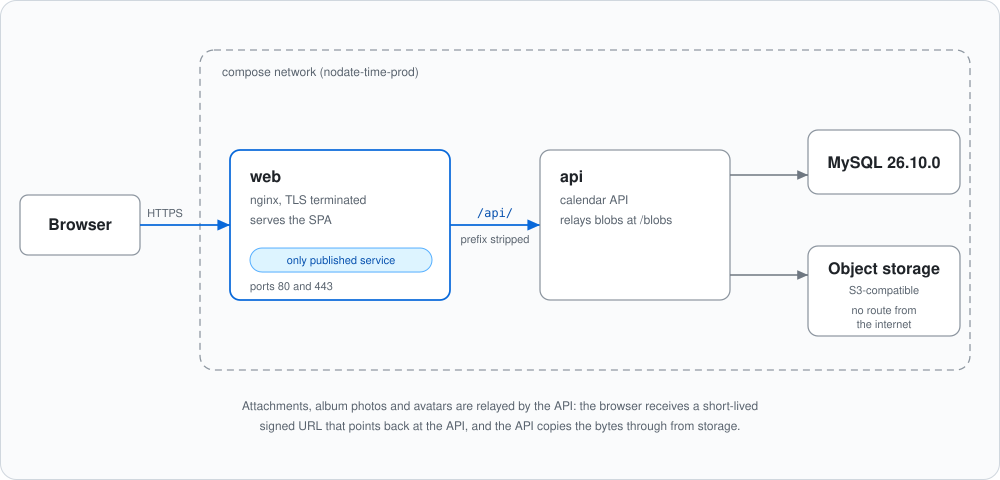

# Deployment

`compose.prod.yml` runs the stack (MySQL, object storage, the API and the built SPA) on a single host. It builds the two images rather than pulling them: the SPA compiles the API origin into its bundle, so no prebuilt image is correct for two deployments.



One hostname, one certificate, and nothing else published. The web service is the only way in: it terminates TLS, serves the SPA, and passes `/api` to the API over the compose network. Neither the API nor object storage needs a route from the internet, and neither is given one. Attachments, album photos and avatars are relayed by the API, which hands the browser a short-lived signed URL back to itself and copies the bytes through.

## TLS certificate

The certificate has to exist before the stack starts; nginx will not load a server block whose certificate is missing. Obtain one first, with port 80 free:

```sh
mkdir -p acme
certbot certonly --standalone -d app.example.com
```

Renewal is answered by the running server out of `acme/`, so nothing has to be stopped for it. nginx keeps the old certificate until it is told to look again:

```sh
certbot renew --webroot -w /path/to/acme \
  --deploy-hook 'docker compose -f /path/to/compose.prod.yml exec web nginx -s reload'
```

`TC_API_PUBLIC_URL` has to carry the `/api` prefix (`https://app.example.com/api`): it is the address the OAuth callback returns to, the address every blob URL points back at, and the path the `$schema` links in responses are built from. `TC_TRUSTED_PROXIES` defaults to `172.16.0.0/12`, the range Docker gives a compose network. If this one was given an address outside it, set the range yourself, or every client collapses onto one rate-limit bucket, since all of them arrive through nginx.

To terminate TLS somewhere else instead, such as a reverse proxy on the host or a tunnel, drop the TLS template mount and the two certificate volumes from the `web` service and publish `127.0.0.1:8081:80`. The image then serves plain HTTP and still proxies `/api` to the API itself, so the arrangement above is unchanged from the browser's side; point the host's proxy at that one port.

## Configuration

Configuration goes in a `.env` beside `compose.prod.yml`. `TC_DB_ROOT_PASSWORD`, `TC_DB_PASSWORD`, `TC_JWT_SECRET` (`openssl rand -hex 32`), `TC_WEB_URL`, `TC_API_PUBLIC_URL`, `TC_PUBLIC_HOST`, `TC_S3_ACCESS_KEY` and `TC_S3_SECRET_KEY` have no safe default: Compose stops and names whichever is missing. `TC_SMTP_HOST` is optional: without a relay no mail is sent, and password reset and email verification are not offered. Every other variable in the [Configuration](configuration.md) table is passed through too, with the same default, except:

- `TC_CORS_ALLOWED_ORIGINS` is always `TC_WEB_URL`; a value in `.env` is ignored.
- `TC_PORT` is not passed: the API listens on 8080 inside the container, and `TC_API_PORT` (default 8080) chooses the host port on loopback.
- `TC_METRICS_ADDR` defaults to `:9464`, because a container cannot bind the host's loopback; the published port is what stays on `127.0.0.1` (`TC_METRICS_PORT`, default 9464).
- `TC_ENV` is always `production`, and `TC_DB_DSN` is assembled from `TC_DB_USER`, `TC_DB_PASSWORD` and `TC_DB_NAME`.

`TC_SECRETS_KEY` is optional. Without it the admin panel refuses to save OAuth client secrets rather than storing them unencrypted.

Every page the web service serves carries a Content-Security-Policy that forbids framing, `nosniff` and `Referrer-Policy: no-referrer`, plus HSTS when it terminates TLS itself. `/embed/*` is the one exception and may be framed by any site. The policy allows scripts and connections from the service's own origin only, so an API served from another origin needs `connect-src` widened in `apps/web/nginx/security-headers.conf`.

## Starting the stack

```sh
docker compose -f compose.prod.yml up -d --build
docker compose -f compose.prod.yml run --rm --entrypoint /createuser api \
  -email you@example.com -password 'choose-a-long-one' -name "Your Name" -admin
```

With `TC_PASSWORD_LOGIN_ENABLED=false`, leave out `-password`. The account is then created without one, and the first Google sign-in whose verified email matches claims it, administrator rights included. An unconfirmed account that holds a password is never linked by a provider, because whoever registered the address could have set it.

The schema is applied when the MySQL volume is first created. `sql/schema.sql` drops every table before creating it, so it is never re-run against a database that holds data; see [Upgrading](#upgrading) for how a schema change reaches one.

## Backups

Two volumes hold everything durable: `mysql_data` and `storage_data`. Back them up together, because an attachment is a row in one pointing at an object in the other. Objects are plain files whose content type and ETag live in extended attributes, so a file-level copy has to keep them (GNU `tar --xattrs --xattrs-include='user.*'`; busybox tar drops them).

A logical dump of the database alone:

```sh
docker compose -f compose.prod.yml exec -T mysql \
  sh -c 'exec mysqldump -uroot -p"$MYSQL_ROOT_PASSWORD" --single-transaction "$MYSQL_DATABASE"' \
  > backup.sql
```

## Upgrading

Back up both volumes first, as described in [Backups](#backups). A database that holds data is never rebuilt: `sql/schema.sql` and `sql/core/tools/build-schema.sh` drop every table they create, so applying either to a live database wipes it. It is brought forward by upgrade files instead, in this order, with the API stopped:

1. `sql/core/upgrades/*.sql`, every file, in number order. These change the tables shared with other products and always come first; the next step refuses to run until they have.
2. `sql/time/upgrades/from-<release>.sql`, for each release between yours and the one you are moving to, oldest first.
3. The conformance check, which confirms the result matches the contract.

```sh
docker compose -f compose.prod.yml stop api
docker compose -f compose.prod.yml cp sql mysql:/tmp/upgrade-sql
docker compose -f compose.prod.yml exec -T mysql bash -euc '
  export MYSQL_PWD="$MYSQL_ROOT_PASSWORD"
  for f in /tmp/upgrade-sql/core/upgrades/*.sql /tmp/upgrade-sql/time/upgrades/from-v0.1.0.sql; do
    echo "applying ${f#/tmp/upgrade-sql/}"
    mysql -uroot "$MYSQL_DATABASE" < "$f"
  done
  bash /tmp/upgrade-sql/core/conformance/run.sh \
    --dsn "root:$MYSQL_ROOT_PASSWORD@127.0.0.1:3306/$MYSQL_DATABASE" --mode schema
  rm -rf /tmp/upgrade-sql
' && docker compose -f compose.prod.yml up -d --build
```

The password and database name are read inside the container, from the values `.env` gave it, so nothing has to be exported on the host. The loop stops at the first file that fails, and the rebuild runs only if every file and the check succeeded. Stop the old API first: a row it deletes after the upgrade has run would read as an upload still awaiting confirmation. Each step checks what is already there, so a run that stopped partway can be repeated, as long as the new API has not yet served a request.

### Allowed sign-in addresses turn the restriction on

The upgrade moves the admin panel's allowed e-mail addresses into the sign-in allowlist the database shares with other products. Any enabled entry there restricts OAuth sign-in to the listed addresses and domains, whether or not `TC_GOOGLE_ALLOWED_DOMAINS` is set. A deployment that left the domain list empty and listed a few addresses as exceptions let everyone sign in before the upgrade; after it, only those addresses can. Withdraw the entries in the admin panel if that is not what you want.

### Rows rewritten once

The upgrade also rewrites some existing rows once:

- activity-log entries take the event names and payload keys shared with other products;
- e-mail addresses are stored lower-case;
- every session is marked as issued by this application;
- storage reference counts are recounted;
- weekly repeats keep the Sunday week start they were shown with.

### Coming from v0.1.0

The deployment itself also changed:

- The web service terminates TLS and publishes 80 and 443 instead of `127.0.0.1:8081`. Obtain a certificate before starting, as described in [TLS certificate](#tls-certificate), or keep the proxy on the host by following the paragraph on terminating TLS elsewhere.
- `TC_PUBLIC_HOST`, the hostname the certificate is issued for, is required.
- `TC_SMTP_HOST` and `TC_SMTP_FROM` are optional. Without a relay, mail is off and password reset and email verification are not offered.
- `TC_TRUSTED_PROXIES` defaults to `172.16.0.0/12`, the range Docker gives a compose network.
- Object storage moved from MinIO (`minio` service, `minio_data` volume) to the Versity S3 Gateway (`storage` service, `storage_data` volume). The formats differ, so the objects are copied over S3 rather than the volume being reused; see [Moving objects off MinIO](#moving-objects-off-minio).

## Object storage

The bundled store is the Versity S3 Gateway over a plain directory: single node, no erasure coding, no versioning, no replication. Durability is the underlying volume plus the backup above, which is the same footing the database is on. It answers only on the private network, and `TC_S3_*` can point at any other S3-compatible endpoint instead without anything above the configuration changing: the API reaches the store, the browser never does, either way.

### Moving objects off MinIO

A deployment from before the switch keeps its objects in `minio_data`, in MinIO's own on-disk format, so they are copied over S3 by the `mc` client inside the old container, which keeps running after the new compose file no longer defines it. Stop the API and apply the upgrades as above, but hold the rebuild until the objects have moved:

```sh
B=nodate-time   # TC_S3_BUCKET
docker compose -f compose.prod.yml up -d --wait storage
OLD=$(docker ps -q --filter label=com.docker.compose.service=minio)
docker exec -e B="$B" "$OLD" sh -c '
  mc alias set old http://localhost:9000 "$MINIO_ROOT_USER" "$MINIO_ROOT_PASSWORD" &&
  mc alias set new http://storage:7070 "$MINIO_ROOT_USER" "$MINIO_ROOT_PASSWORD" &&
  mc mb --ignore-existing "new/$B" &&
  mc mirror --preserve "old/$B" "new/$B"'
echo "SELECT storage_key, content_type FROM storage_objects WHERE storage_key LIKE 'albums/%.thumb'" |
  docker compose -f compose.prod.yml exec -T mysql \
    sh -c 'exec mysql -N -uroot -p"$MYSQL_ROOT_PASSWORD" "$MYSQL_DATABASE"' |
  while read -r key type; do
    docker exec -e B="$B" -e P="${key%.thumb}" -e T="$type" "$OLD" sh -c '
      mc cat "old/$B/$P/thumb" > /tmp/thumb &&
      curl -sf --aws-sigv4 aws:amz:us-east-1:s3 --user "$MINIO_ROOT_USER:$MINIO_ROOT_PASSWORD" \
        -H "Content-Type: $T" -T /tmp/thumb "http://storage:7070/$B/$P.thumb"' </dev/null ||
      echo "not copied: $key"
  done
docker compose -f compose.prod.yml up -d --build --remove-orphans
```

Thumbnails need the second step. v0.1.0 stored one underneath its photo (`<photo>/thumb`), a key the new store cannot hold beside the photo itself, and MinIO does not list a key that sits under another object, so `mc mirror` never sees them. The upgrade file has already moved their rows to `<photo>.thumb`; the loop reads that list and copies each one to its new key. A `not copied` line names a thumbnail the old store did not have.

Both stores take the same `TC_S3_*` credentials, so the old container's own variables serve for both. Keep the `minio_data` volume until attachments, album photos and avatars have been checked in the running app, then remove it with `docker volume rm`.

## Migrating from TimeTree

`importtimetree` copies shared calendars out of TimeTree and keeps track of whose event each one is. It logs in to TimeTree itself, fetches every calendar and event up front, then creates the accounts, calendars and members a mapping file describes and imports the events under the owners it assigns. It ships in the API image as `/importtimetree`.

Before you start:

- Every email in the mapping must be the address that person signs in with through Google. The accounts are created without passwords, and the first Google sign-in whose verified email matches claims one. An address nobody can sign in with leaves an account nobody can reach.
- Set `TIMETREE_EMAIL` and `TIMETREE_PASSWORD` for the command (see [Configuration](configuration.md)). They are read from the environment so they never show up in the process list.

### Mapping file

```yaml
importer: ops@example.com # runs the import; owns the calendars and is the default owner
users: # accounts to create (existing ones are skipped)
  - email: hanako@example.com
    name: Hanako Yamada # defaults to the local part of the email
calendars:
  - timetree: Band # the TimeTree calendar's name or alias code
    name: Band # name here; defaults to the TimeTree name
    default_owner: mgr@example.com # owner of events with no mapped label; defaults to importer
    members:
      - { email: hanako@example.com, role: viewer }
      - { email: mgr@example.com, role: manager }
    labels: # TimeTree label name -> owner's email
      Hanako: hanako@example.com
```

- `importer` is the existing or newly created account the import runs as. It becomes the owner of every calendar, so it must not be listed under `members`.
- `users` lists the accounts to create. An address that already has an account is left alone.
- `calendars[].timetree` selects one active TimeTree calendar by name or alias code.
- `calendars[].name` is the calendar's name here. An existing calendar of that name that the importer belongs to (other than a personal one) is reused.
- `members` gives each person a role: `manager`, `editor` or `viewer`. An existing member keeps the role they have.
- `labels` maps TimeTree label names to the person who owns those events. Events with no label, or a label not listed, go to `default_owner`.

Everything is checked before anything is written, and any of these stops the command with nothing written:

- an unknown key, a duplicate entry or an unknown role
- a malformed or non-ASCII email
- an owner who is not a member of the calendar
- a `timetree` value that matches no calendar, or more than one
- a mapped label that no TimeTree label matches
- two existing calendars with the same name

### Dry run first

```sh
docker compose -f compose.prod.yml run --rm -T -e TIMETREE_EMAIL -e TIMETREE_PASSWORD \
  --entrypoint /importtimetree api -mapping - -dry-run < mapping.yaml
```

`-mapping` takes a path or `-` for standard input. With `-dry-run` the command logs in, fetches and validates, prints the report and writes nothing. For each TimeTree calendar the report shows the event count, the earliest start date, the count per label (including events with no label), what would be skipped and why, the number of events that have attendees, the number of timed events recorded in UTC, and three all-day events with their raw and converted times. For each calendar in the mapping it adds the count per owner, whether the calendar would be created or reused, and the accounts that would be created. Validation errors are listed at the end. Read the label and owner counts for a label missing from the mapping, and compare the earliest dates and the all-day examples with what TimeTree shows.

### Running it

With ansible, from `ansible/`:

```sh
ansible-playbook import-timetree.yml -e timetree_mapping=/path/to/mapping.yaml --check   # dry run
ansible-playbook import-timetree.yml -e timetree_mapping=/path/to/mapping.yaml
```

The mapping file stays on the controller and reaches the container on standard input; the credentials come from `timetree_email` and `timetree_password` in `vault.yml`. `--check` runs the importer with `-dry-run`.

| Exit code | Meaning                                                                                                                 |
| --------- | ----------------------------------------------------------------------------------------------------------------------- |
| 0         | Success.                                                                                                                |
| 1         | One or more events failed while writing. Others were imported.                                                          |
| 2         | Nothing was written: bad input, missing credentials, a validation error, or a failed login or fetch. Safe to run again. |

Events are identified by their TimeTree id, so running the same import again imports nothing new and reports the already-imported events as duplicates.

### What is not migrated

Attendees, comments, attachments, reminders, memos, birthdays, public calendars and deactivated calendars are not imported; the report counts what it skips. Calendar colors take the default. Events keep only the owner the label gives them.

### Run it before cutover only

The importer does not update what it has already imported. Run it again after people have started using the app and it brings back events they deleted and members they removed, and creates a second calendar for each one they renamed. Re-running is for redoing the migration before cutover, not for catching up afterwards.
