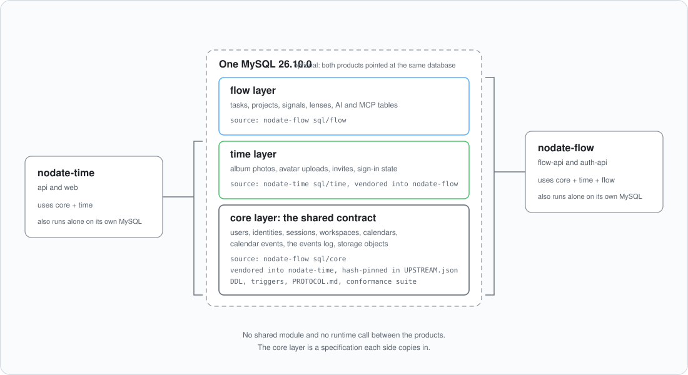

# Introduction

Nodate Time is a shared calendar for running one calendar across several people: families, teams and agencies. It is self-hosted and ships as a Go REST API plus a React single-page app, on MySQL and S3-compatible object storage.

## Model

- A **calendar** has **members**, each with a role: owner, manager, editor or viewer. The role sets what a member can do in that calendar.
- A calendar is shared by invite link, by a public share token (read-only view), or by an embeddable view that any site may frame.
- Events, memos and albums belong to a calendar. Events support all-day and timed entries, recurrence (RRULE) with per-occurrence exceptions, attendees, checklists, attachments and comments.
- Every change to an event or memo is recorded, and each calendar has an activity feed.

The calendar-sharing experience is inspired by TimeTree, and the role-based permission model is in the style of Google Calendar.

The structure of the HTTP API follows TimeTree's: resources hang off `/calendars/{calendarId}/…`, with events, memos, members and invites as sub-resources. The visual design is independent.

## Optional shared database with nodate-flow

Nodate Time is a standalone product. It runs against its own MySQL database and has no code dependency on any other project.

It can also share one MySQL database with [nodate-flow](https://github.com/libraz/nodate-flow), the task platform from the same author. In that arrangement users, groups and calendar data live in one place and both products read and write them.

The two products interoperate through a published schema contract, not through each other's code. `sql/core/` holds the contract's tables, triggers, upgrade scripts and conformance suite, vendored from nodate-flow and pinned in `sql/core/UPSTREAM.json`; it is not edited in this repository. `sql/time/` holds the tables that belong to Nodate Time alone, and the build composes core first, then time. Both layers are applied to the same database, and the conformance suite (`make test-conformance`) checks the result against the contract. `sql/core/PROTOCOL.md` is the full specification.

When nodate-flow projects a task onto a calendar, the event carries `taskOwned: true`, and its title, dates and recurrence change on the task rather than on the calendar.

Without nodate-flow, none of this is visible: the core tables are simply part of Nodate Time's schema.

## Disclaimer and trademarks

This is an independent, original project. It is inspired by the shared-calendar experience of TimeTree, but the code, UI and UX are its own. No source, assets or designs are copied from any third party.

"TimeTree", "Google Calendar" and other product names are trademarks of their respective owners and are used here only for descriptive reference. This project is not affiliated with, endorsed by, or sponsored by any of them.

## Where to go next

- [Development](development.md): tech stack, repository layout, tests, migrations and code generation.
- [Deployment](deployment.md): the self-hosting stack, upgrades, object storage and backups.
- [Configuration](configuration.md): every `TC_*` environment variable.
- [Observability](observability.md): metrics, profiling, health detail and logging.
- [API overview](api.md): route groups and how the OpenAPI description is served.
