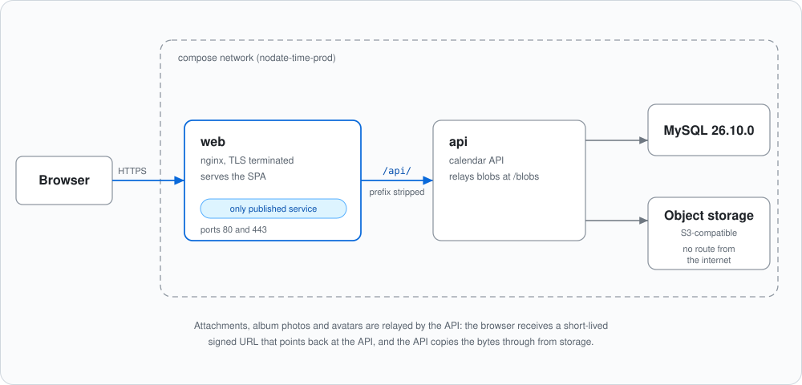

# デプロイ

`compose.prod.yml` が、MySQL・オブジェクトストレージ・API・ビルド済み SPA を 1 台のホスト上でまとめて動かします。イメージは pull せずその場でビルドします。SPA は API のオリジンをバンドルに焼き込むため、2 つのデプロイ先に対して正しいビルド済みイメージは存在しません。



ホスト名 1 つ、証明書 1 枚で、公開するポートはそれだけです。入口は web サービスのみで、TLS の終端、SPA の配信、`/api` の API への中継（compose ネットワーク越し）を担います。API もオブジェクトストレージもインターネットからの経路を必要とせず、与えてもいません。添付・アルバム写真・アバターは API が中継します。ブラウザには API 自身へ戻る短命の署名付き URL を渡し、バイトはその上をコピーして流します。

## TLS 証明書

証明書はスタックを起動する前に存在している必要があります。証明書のない server ブロックを nginx が読み込まないためです。ポート 80 を空けた状態で先に取得します。

```sh
mkdir -p acme
certbot certonly --standalone -d app.example.com
```

更新は稼働中のサーバが `acme/` から応答するので、止めるものは何もありません。ただし nginx は再読み込みを指示されるまで古い証明書を持ち続けます。

```sh
certbot renew --webroot -w /path/to/acme \
  --deploy-hook 'docker compose -f /path/to/compose.prod.yml exec web nginx -s reload'
```

`TC_API_PUBLIC_URL` には `/api` の prefix が必要です（`https://app.example.com/api`）。OAuth のコールバックが戻ってくる先であり、blob URL が指し戻す先であり、レスポンスの `$schema` リンクを組み立てる元でもあるためです。`TC_TRUSTED_PROXIES` の既定は、Docker が compose ネットワークに割り当てるレンジ `172.16.0.0/12` です。ネットワークがその外に置かれた場合は、レンジを自分で設定してください。全クライアントが nginx を通って届くので、合っていないとレート制限が 1 バケットに潰れます。

TLS を別の場所で終端したい場合（ホスト上のリバースプロキシやトンネルなど）は、`web` サービスから TLS テンプレートのマウントと証明書の 2 つのボリュームを外し、`127.0.0.1:8081:80` を publish します。イメージは平文 HTTP で応答し、`/api` は同じように自分で API へ流すので、ブラウザから見た構成は上と変わりません。ホスト側のプロキシはその 1 ポートだけを向ければ足ります。

## 設定

設定は `compose.prod.yml` と同じ場所の `.env` に置きます。`TC_DB_ROOT_PASSWORD`・`TC_DB_PASSWORD`・`TC_JWT_SECRET`（`openssl rand -hex 32`）・`TC_WEB_URL`・`TC_API_PUBLIC_URL`・`TC_PUBLIC_HOST`・`TC_S3_ACCESS_KEY`・`TC_S3_SECRET_KEY` には安全な既定値がなく、未設定なら Compose が該当する変数名を出して停止します。`TC_SMTP_HOST` は省略できます。なければメール送信はオフで、パスワード再設定とメール確認は提供されません。[設定](configuration.md)の表のその他の変数も、同じ既定値のまま渡ります。例外は次のとおりです。

- `TC_CORS_ALLOWED_ORIGINS` は常に `TC_WEB_URL` になります。`.env` に書いた値は無視されます。
- `TC_PORT` は渡しません。API はコンテナ内で 8080 を待ち受け、ホスト側の loopback ポートは `TC_API_PORT`（既定 8080）で決めます。
- `TC_METRICS_ADDR` の既定は `:9464` です。コンテナはホストの loopback にバインドできないためです。`127.0.0.1` に閉じているのは公開側のポート（`TC_METRICS_PORT`、既定 9464）です。
- `TC_ENV` は常に `production`、`TC_DB_DSN` は `TC_DB_USER`・`TC_DB_PASSWORD`・`TC_DB_NAME` から組み立てられます。

`TC_SECRETS_KEY` は任意です。設定しない場合、管理画面は OAuth のクライアントシークレットを平文で保存する代わりに、保存自体を拒否します。

web サービスが返すページにはすべて、フレーム埋め込みを禁じる Content-Security-Policy、`nosniff`、`Referrer-Policy: no-referrer` が付き、TLS を自分で終端する場合は HSTS も付きます。例外は `/embed/*` で、どのサイトからでもフレームに入れられます。ポリシーが許すスクリプトと接続先は配信元と同じオリジンだけなので、別オリジンで API を配信する場合は `apps/web/nginx/security-headers.conf` の `connect-src` を広げてください。

## スタックの起動

```sh
docker compose -f compose.prod.yml up -d --build
docker compose -f compose.prod.yml run --rm --entrypoint /createuser api \
  -email you@example.com -password 'choose-a-long-one' -name "Your Name" -admin
```

`TC_PASSWORD_LOGIN_ENABLED=false` で運用する場合は `-password` を省いてください。パスワードの無いアカウントができ、確認済みのメールアドレスが一致する最初の Google サインインが、管理者権限ごとそのアカウントを引き取ります。メールアドレスが未確認でパスワードを持つアカウントには、プロバイダからは紐づけません。そのパスワードは、アドレスの持ち主でない誰かが登録時に設定したものかもしれないからです。

スキーマは MySQL のボリュームを最初に作ったときに適用されます。`sql/schema.sql` は全テーブルを DROP してから作り直すので、データの入った DB には流し直しません。スキーマの変更を既存の DB に当てる方法は[既存環境の更新](#既存環境の更新)を参照してください。

## バックアップ

永続データは `mysql_data` と `storage_data` の 2 つのボリュームに入っています。バックアップは必ず両方を揃えて取ります。添付ファイルは、片方の行がもう片方のオブジェクトを指す形で成立しているためです。オブジェクトは普通のファイルで、content type と ETag は拡張属性に入っています。ファイル単位でコピーするなら拡張属性も残してください（GNU `tar --xattrs --xattrs-include='user.*'`。busybox の tar は落とします）。

データベースだけの論理ダンプは次のとおりです。

```sh
docker compose -f compose.prod.yml exec -T mysql \
  sh -c 'exec mysqldump -uroot -p"$MYSQL_ROOT_PASSWORD" --single-transaction "$MYSQL_DATABASE"' \
  > backup.sql
```

## 既存環境の更新

先に[バックアップ](#バックアップ)のとおり 2 つのボリュームを保存します。データの入った DB は作り直しません。`sql/schema.sql` も `sql/core/tools/build-schema.sh` も、作るテーブルをすべて DROP してから作り直すので、稼働中の DB に流すとデータが消えます。既存の DB は更新用の SQL で上げます。API と、同じ DB に書き込む他のプロダクトをすべて止めたうえで、次の順に当てます。

1. `sql/core/upgrades/*.sql` を、番号順にすべて。他のプロダクトと共有するテーブルを変更するもので、必ず最初に当てます。これが済むまで次の手順は実行を拒否します。
2. `sql/time/upgrades/from-v0.1.0.sql` を、まだ当てていない DB にだけ。`album_photos.retired_at` 列がなければ未適用です。新しい API が一度でもリクエストを処理したら、二度と流しません。
3. 機能ごとのファイルを、`schedule-polls.sql`、`calendar-covers.sql` の順に。足りないものだけを足し、ビューは置き換えるので、手順 2 を済ませたどの DB にも当てられます。
4. `sql/time/upgrades/triggers.sql` を最後に。この層のトリガーをすべて DROP して作り直します。MySQL はトリガーを不可分に置き換えられないので、その間に走った削除はトリガーを通りません。書き込む側をすべて止めるのはこのためです。
5. 適合性検査。結果が契約どおりになっているかを確かめます。

```sh
docker compose -f compose.prod.yml stop api
docker compose -f compose.prod.yml cp sql mysql:/tmp/upgrade-sql
docker compose -f compose.prod.yml exec -T mysql bash -euc '
  export MYSQL_PWD="$MYSQL_ROOT_PASSWORD"
  up=/tmp/upgrade-sql/time/upgrades
  apply() { echo "applying ${1#/tmp/upgrade-sql/}"; mysql -uroot "$MYSQL_DATABASE" < "$1"; }
  for f in /tmp/upgrade-sql/core/upgrades/*.sql; do apply "$f"; done
  if ! mysql -uroot "$MYSQL_DATABASE" -e "SELECT retired_at FROM album_photos LIMIT 0" 2>/dev/null; then
    apply "$up/from-v0.1.0.sql"
  fi
  for f in schedule-polls calendar-covers triggers; do apply "$up/$f.sql"; done
  bash /tmp/upgrade-sql/core/conformance/run.sh \
    --dsn "root:$MYSQL_ROOT_PASSWORD@127.0.0.1:3306/$MYSQL_DATABASE" --mode schema
  rm -rf /tmp/upgrade-sql
' && docker compose -f compose.prod.yml up -d --build
```

パスワードとデータベース名はコンテナの中で、`.env` から渡された値として読まれるので、ホスト側で export する必要はありません。スクリプトは失敗したファイルで止まり、再ビルドはすべてのファイルと検査が成功したときだけ走ります。旧版の API は先に止めてください。更新が済んだあとに旧版が削除した行は、確認待ちのアップロードに見えてしまいます。各ステップは現状を確かめてから動くので、途中で止まったものは、新しい API がまだリクエストを処理していない限り、もう一度流せます。

### 許可したメールアドレスがあるとサインインの制限が有効になる

更新では、管理画面で許可したメールアドレスを、DB が他のプロダクトと共有するサインイン許可リストへ移します。このリストに有効な行が 1 つでもあれば、`TC_GOOGLE_ALLOWED_DOMAINS` の設定の有無にかかわらず、OAuth でサインインできるのはリストにあるアドレスとドメインだけになります。ドメインのリストを空にしたまま、例外としていくつかのアドレスを登録していたデプロイでは、更新前は誰でもサインインできましたが、更新後はそのアドレスしか入れません。意図しない場合は、管理画面で該当の行を取り下げてください。

### 一度だけ書き換わる行

既存の行のうち、次のものは更新時に一度だけ書き換わります。

- アクティビティログの記録は、他のプロダクトと共通のイベント名と payload のキーになります。
- メールアドレスは小文字で保存されます。
- すべてのセッションに、本アプリが発行したという印が付きます。
- ストレージの参照数は数え直されます。
- 毎週の繰り返しは、これまで表示していた日曜始まりの週のまま残ります。

### v0.1.0 から上げる場合

配備の形も変わっています。

- web サービスが TLS を終端し、`127.0.0.1:8081` の代わりに 80 と 443 を公開します。起動前に [TLS 証明書](#tls-証明書)の手順で証明書を取得するか、ホスト側のプロキシを使い続けるなら、TLS を別の場所で終端する場合の段落に従ってください。
- 証明書を発行するホスト名 `TC_PUBLIC_HOST` が必須になりました。
- `TC_SMTP_HOST` と `TC_SMTP_FROM` は省略できます。SMTP リレーがなければメール送信はオフで、パスワード再設定とメール確認は提供されません。
- `TC_TRUSTED_PROXIES` の既定値が、Docker が compose のネットワークに割り当てる範囲 `172.16.0.0/12` になりました。
- オブジェクトストレージが MinIO（`minio` サービス、`minio_data` ボリューム）から Versity S3 Gateway（`storage` サービス、`storage_data` ボリューム）に変わりました。保存形式が違うのでボリュームは流用できず、S3 経由でオブジェクトを移します。手順は[MinIO からの移行](#minio-からの移行)を参照してください。

## オブジェクトストレージ

同梱のストレージは、普通のディレクトリの上で動く Versity S3 Gateway です。単一ノードで、erasure coding もバージョニングもレプリケーションもありません。耐久性は下のボリュームと上記のバックアップに依存し、データベースと同じ足場の上にあります。プライベートネットワークにしか応答しません。`TC_S3_*` を任意の S3 互換エンドポイントに向ければ差し替えられ、設定より上は何も変わりません。どちらの場合も、ストレージに触るのは API で、ブラウザではありません。

### MinIO からの移行

切り替え前のデプロイは、オブジェクトを MinIO 独自の形式で `minio_data` に持っているので、S3 経由でコピーします。新しい compose ファイルに `minio` サービスはもうありませんが、旧コンテナは動き続けるので、その中の `mc` を使います。上記のとおり API を止めて更新用の SQL を当て、再ビルドはオブジェクトを移し終えるまで待ちます。

```sh
B=nodate-time   # TC_S3_BUCKET
docker compose -f compose.prod.yml up -d --wait storage
OLD=$(docker ps -q --filter label=com.docker.compose.service=minio)
docker exec -e B="$B" "$OLD" sh -c '
  mc alias set old http://localhost:9000 "$MINIO_ROOT_USER" "$MINIO_ROOT_PASSWORD" &&
  mc alias set new http://storage:7070 "$MINIO_ROOT_USER" "$MINIO_ROOT_PASSWORD" &&
  mc mb --ignore-existing "new/$B" &&
  mc mirror --preserve "old/$B" "new/$B"'
echo "SELECT storage_key, content_type FROM storage_objects WHERE storage_key LIKE 'albums/%.thumb'" |
  docker compose -f compose.prod.yml exec -T mysql \
    sh -c 'exec mysql -N -uroot -p"$MYSQL_ROOT_PASSWORD" "$MYSQL_DATABASE"' |
  while read -r key type; do
    docker exec -e B="$B" -e P="${key%.thumb}" -e T="$type" "$OLD" sh -c '
      mc cat "old/$B/$P/thumb" > /tmp/thumb &&
      curl -sf --aws-sigv4 aws:amz:us-east-1:s3 --user "$MINIO_ROOT_USER:$MINIO_ROOT_PASSWORD" \
        -H "Content-Type: $T" -T /tmp/thumb "http://storage:7070/$B/$P.thumb"' </dev/null ||
      echo "not copied: $key"
  done
docker compose -f compose.prod.yml up -d --build --remove-orphans
```

サムネイルには 2 段目が必要です。v0.1.0 はサムネイルを写真の下（`<photo>/thumb`）に置いていました。新しいストレージは写真本体と並べてこのキーを持てず、MinIO は別のオブジェクトの下にあるキーを一覧に出さないので、`mc mirror` からは見えません。更新用の SQL がその行をすでに `<photo>.thumb` に書き換えているので、ループはその一覧を読み、1 件ずつ新しいキーへコピーします。`not copied` と出たものは、旧ストレージに中身がなかったサムネイルです。

どちらのストレージも同じ `TC_S3_*` 認証情報を受け取るので、旧コンテナ自身の環境変数がそのまま両方に使えます。`minio_data` ボリュームは、稼働中のアプリで添付・アルバム写真・アバターを確かめるまで残し、そのあと `docker volume rm` で消します。

## TimeTree からの移行

`importtimetree` は、TimeTree の共有カレンダーを、誰の予定かという割り当てごと取り込みます。TimeTree には自分でログインし、全カレンダーと全予定を先に取得します。そのあと、対応表に書かれたアカウント・カレンダー・メンバーを作り、割り当てた所有者で予定を入れます。API イメージに `/importtimetree` として入っています。

始める前に次の点を確認してください。

- 対応表のメールアドレスは、すべて本人が Google ログインに使うアドレスにしてください。アカウントはパスワードなしで作られ、検証済みのメールが一致する最初の Google サインインがそのアカウントを引き取ります。誰もサインインできないアドレスを書くと、誰も入れないアカウントが残ります。
- コマンドに `TIMETREE_EMAIL` と `TIMETREE_PASSWORD` を渡します（[設定](configuration.md)を参照）。プロセス一覧に出ないよう、環境変数から読みます。

### 対応表

```yaml
importer: ops@example.com # 取り込みの実行者。カレンダーの owner で、既定の所有者
users: # 作成するアカウント（既存のものはスキップ）
  - email: hanako@example.com
    name: 山田花子 # 省略時はメールのローカル部
calendars:
  - timetree: Band # TimeTree カレンダーの name または alias_code
    name: Band # こちら側の名前。省略時は TimeTree の name
    default_owner: mgr@example.com # 対応するラベルがない予定の所有者。省略時は importer
    default_attendees: [hanako@example.com] # その予定の参加者。省略可
    members:
      - { email: hanako@example.com, role: viewer }
      - { email: mgr@example.com, role: manager }
    labels: # TimeTree のラベル名 → 所有者のメール
      花子: hanako@example.com
```

- `importer` は取り込みを実行するアカウントです。既存のアカウントでも、`users` に書いて新規に作るものでも構いません。すべてのカレンダーの owner になるので、`members` には書けません。
- `users` は作成するアカウントの一覧です。すでにアカウントのあるアドレスには手を付けません。
- `calendars[].timetree` は、停止していない TimeTree カレンダーを name か alias_code で 1 つ選びます。
- `calendars[].name` はこちら側のカレンダー名です。importer がメンバーである同名のカレンダー（個人カレンダーを除く）が既にあれば、それを再利用します。
- `members` は各人のロールで、`manager`・`editor`・`viewer` のいずれかです。既にメンバーの人のロールは変えません。
- `labels` は、TimeTree のラベル名と、その予定を持つ人の対応です。ラベルのない予定と、ここに書かれていないラベルの予定は `default_owner` になります。
- `default_attendees` に書いた人は、`default_owner` に入る予定（グループ全体のレッスンなど）の参加者になります。それぞれメンバーか importer である必要があります。対応するラベルがある予定には参加者を付けません。参加者は空き時間の検索で予定ありとして数えられ、参加者が 2 人以上の予定には所有者の写真の代わりに色の点が表示されます。

検証は書き込みの前にすべて済ませます。次のどれかに当たると、何も書かずに終了します。

- 未知のキー、重複するエントリ、未知のロール
- 形の崩れたメール、ASCII 以外を含むメール
- カレンダーのメンバーでない所有者
- どのカレンダーにも一致しない、または複数に一致する `timetree`
- どの TimeTree ラベルにも一致しないラベル
- 同名の既存カレンダーが 2 つある

### まず dry-run

```sh
docker compose -f compose.prod.yml run --rm -T -e TIMETREE_EMAIL -e TIMETREE_PASSWORD \
  --entrypoint /importtimetree api -mapping - -dry-run < mapping.yaml
```

`-mapping` にはパスか、標準入力を表す `-` を渡します。`-dry-run` を付けると、ログイン・取得・検証をしてレポートを出すだけで、何も書きません。レポートには TimeTree のカレンダーごとに、予定の総数、最古の開始日、ラベル別の件数（ラベルなしを含む）、スキップされる予定とその理由、参加者付きの予定数、UTC で記録された時刻予定の数、終日予定 3 件の生の値と変換後の値が出ます。対応表にあるカレンダーには、さらに所有者別の件数、作成か再利用か、作成されるアカウントが加わります。検証エラーは最後にまとめて並びます。対応表に漏れているラベルがないかをラベル別・所有者別の件数で見て、最古の日付と終日予定の例を TimeTree の表示と見比べてください。

### 実行

ansible からは、`ansible/` で次のように流します。

```sh
ansible-playbook import-timetree.yml -e timetree_mapping=/path/to/mapping.yaml --check   # dry-run
ansible-playbook import-timetree.yml -e timetree_mapping=/path/to/mapping.yaml
```

対応表は制御側に置いたまま、標準入力でコンテナに渡します。認証情報は `vault.yml` の `timetree_email` と `timetree_password` から取ります。`--check` では `-dry-run` を付けて実行します。

| 終了コード | 意味                                                                                                   |
| ---------- | ------------------------------------------------------------------------------------------------------ |
| 0          | 成功。                                                                                                 |
| 1          | 書き込み中に失敗した予定が 1 件以上ある。ほかの予定は取り込まれている。                                |
| 2          | 何も書いていない。入力の不備、認証情報の欠落、検証エラー、ログインや取得の失敗。もう一度実行して安全。 |

予定は TimeTree の id で識別するので、同じ取り込みをもう一度流しても新しく入るものはなく、取り込み済みの予定は重複として報告されます。

### 移行されないもの

参加者、コメント、添付、リマインダー、メモ、誕生日、公開カレンダー、停止済みのカレンダーは取り込みません。スキップしたものはレポートに件数が出ます。カレンダーの色は既定色になります。予定の持ち主は、ラベルから決まる所有者だけです。

### 実行はカットオーバー前だけ

取り込み済みの予定を、再実行で更新することはありません。人がアプリを使い始めたあとに流し直すと、削除した予定と外したメンバーが戻り、改名したカレンダーはそのたびに 2 つ目が作られます。再実行はカットオーバー前に移行をやり直すためのもので、切り替え後に差分を取り込むためのものではありません。
