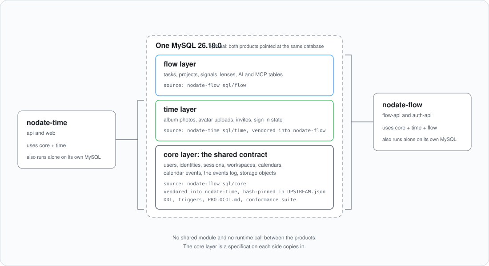

# 概要

Nodate Time は、家族・チーム・事務所など複数人で 1 つのカレンダーを運用するための共有カレンダーです。自己ホスト型で、Go 製の REST API と React のシングルページアプリで構成され、MySQL と S3 互換のオブジェクトストレージの上で動きます。

## モデル

- **カレンダー**には**メンバー**がいて、それぞれにロール（owner / manager / editor / viewer）があります。ロールが、そのカレンダーでメンバーにできることを決めます。
- カレンダーは、招待リンク、公開共有トークン（閲覧専用）、どのサイトからもフレームに入れられる埋め込みビューのいずれかで共有します。
- 予定・メモ・アルバムはカレンダーに属します。予定は終日と時間指定、例外日を持てる繰り返し（RRULE）、参加者、チェックリスト、添付ファイル、コメントに対応しています。
- 予定には担当者（その予定の持ち主のメンバー）がいて、ほかの参加者を加えられます。空き状況（予定あり・空き・仮・不在）はその人の時間が埋まるかどうかを表し、公開範囲は共有リンクに予定のどこまでを見せるかを決めます。カレンダーごとに色付きのラベルを定義し、予定に 1 つ付けられます。
- 日程調整では、選んだメンバーに候補日時を送ります。回答は集計され、日時を確定すると予定が作られます。空き状況を共有しているカレンダーの埋まっている時間と、候補を突き合わせられます。
- 予定とメモの変更はすべて履歴に残り、カレンダーごとにアクティビティフィードがあります。
- スマートフォンやパソコンのカレンダーアプリとは CalDAV で同期します。端末ごとに専用のアプリパスワードでサインインします。

カレンダーを共有する体験は TimeTree に、ロールによる権限モデルは Google Calendar に着想を得ています。

HTTP API の構造は TimeTree に寄せています。リソースは `/calendars/{calendarId}/…` の下にぶら下がり、予定・メモ・メンバー・招待がサブリソースになります。見た目のデザインは独立しています。

## nodate-flow との任意の共有データベース

Nodate Time は単体で動くプロダクトです。専用の MySQL データベースで動作し、他のプロジェクトへのコード依存はありません。

同じ作者のタスク基盤 [nodate-flow](https://github.com/libraz/nodate-flow) と、1 つの MySQL データベースを共有することもできます。その場合、ユーザー・グループ・カレンダーのデータが 1 か所に置かれ、両方のプロダクトが読み書きします。

2 つのプロダクトはお互いのコードではなく、公開されたスキーマ契約を介して連携します。`sql/core/` に契約のテーブル、トリガ、更新用 SQL、適合性検査が入っています。nodate-flow から vendor したコピーで、`sql/core/UPSTREAM.json` で上流に固定されており、このリポジトリでは編集しません。`sql/time/` は Nodate Time だけが持つテーブルで、ビルドは core、time の順に結合します。両方の層が同じデータベースに適用され、適合性検査（`make test-conformance`）が結果を契約と突き合わせます。仕様の全文は `sql/core/PROTOCOL.md` です。

nodate-flow がタスクをカレンダーに投影した予定には `taskOwned: true` が付き、タイトル・日付・繰り返しはカレンダー側ではなくタスク側で変更します。

nodate-flow を使わない場合、これらは見えません。core のテーブルは Nodate Time のスキーマの一部として存在するだけです。

## 免責事項・商標について

本プロジェクトは独立した独自プロジェクトです。TimeTree の共有カレンダー体験に着想を得ていますが、コード・UI・UX はすべて独自実装であり、第三者のソース・素材・デザインを流用していません。

"TimeTree"、"Google Calendar" その他の製品名は各社の商標であり、本ドキュメントでは説明のための参照としてのみ使用しています。本プロジェクトはこれらの企業と提携・公認・後援の関係にありません。

## 次に読むもの

- [開発](development.md): 技術スタック、ディレクトリ構成、テスト、マイグレーションとコード生成。
- [デプロイ](deployment.md): 自己ホスト用スタック、カレンダーアプリ、更新、オブジェクトストレージ、バックアップ、TimeTree からの移行。
- [設定](configuration.md): `TC_*` 環境変数の一覧。
- [可観測性](observability.md): メトリクス、プロファイル、ヘルスの詳細、ログ。
- [API 概要](api.md): ルートのグループ、共通の規約、アプリパスワード、CalDAV サーバー。
